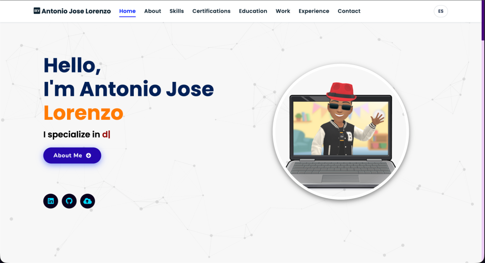
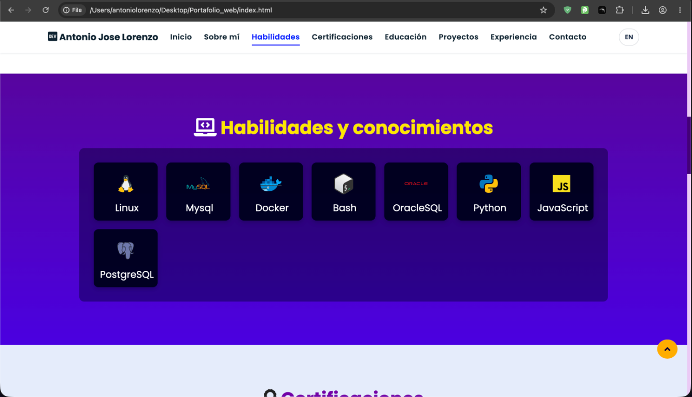

# Portafolio web

Este es mi portafolio personal. Aquí comparto un poco sobre mí, mi experiencia y algunos de mis proyectos. Está hecho con HTML, CSS y JavaScript.

## Así se ve

## Idiomas

El sitio está disponible en español e inglés. El botón `ES`/`EN` cambia el idioma y recuerda tu elección mientras navegas.

Si quieres cambiar los textos, edita las traducciones en `assets/js/language.js`. Los textos de la portada también tienen versiones de respaldo en `index.html` y `assets/js/script.js`.

## Currículum

El enlace de CV de la sección “Sobre mí” muestra el archivo correspondiente al idioma:

- Español: `experience/RESUMECV/CV.pdf`
- Inglés: `experience/RESUMECV/cv.pdf`

Si reemplazas los archivos, conserva sus nombres o actualiza las rutas en `index.html`.

## Proyectos y experiencia

- Los proyectos están en `projects/projects.json`. Puedes añadir `name_es` y `desc_es` para mostrar sus nombres y descripciones en español.
- La experiencia resumida aparece en `index.html` y la lista completa en `experience/index.html`.
- Las habilidades se cargan desde `skills.json` y las certificaciones desde `certifications.json`.
- Para actualizar la colección completa de certificados, cambia el enlace en `index.html`.

## Probar el sitio

Sirve la carpeta del proyecto con un servidor HTTP local para probar las páginas, los archivos y el cambio de idioma. Abrir los archivos HTML directamente puede impedir que se carguen algunos datos.
